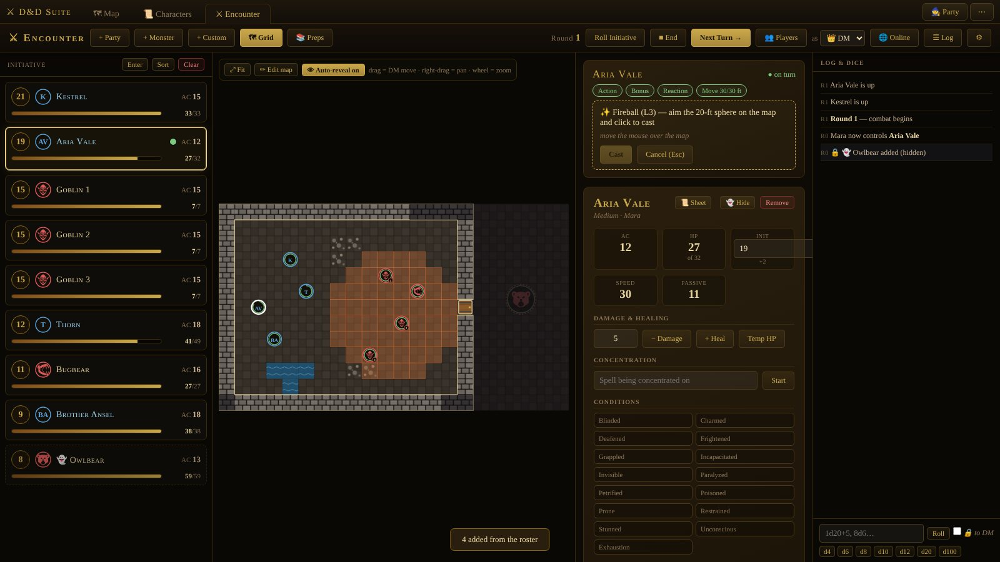
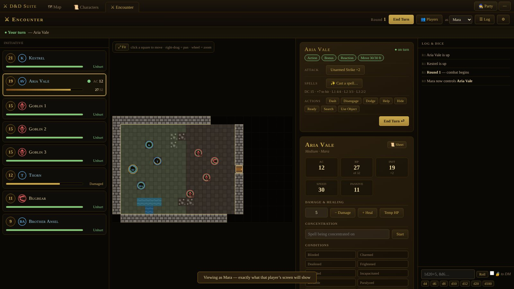
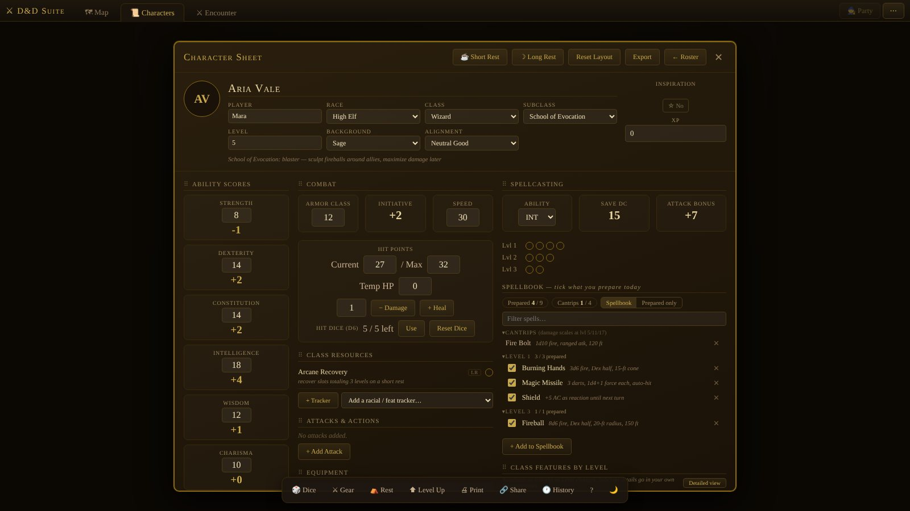

# ⚔ D&D Suite

**A world map, character sheets and a rules-aware battle map for D&D 5e — in one HTML file.**
No install, no account, no database. Double-click `dnd-suite.html` and play. When you want your players at the table over the internet, run one small Python script.

**[▶ Try it in your browser](https://arvi23.github.io/dnd-suite/dnd-suite.html)** · **[Project page](https://arvi23.github.io/dnd-suite/)** · **[Full manual](docs/MANUAL.md)** · **[Changelog](CHANGELOG.md)**



## What's inside

| Tab | What it does |
|---|---|
| 🗺 **Map** | World-map editor: regions, kingdoms, pins, fog of war, per-place notes, and a one-click **Sync from Obsidian** vault import. Exports a spoiler-free player map. |
| 📜 **Characters** | Full 5e character sheets: every class's spell list with prepare checkboxes, spell slots, class resources (rage, ki, superiority dice…), rests, level-up. One roster shared by every tab. |
| ⚔ **Encounter** | Initiative tracker and battle grid that knows the rules (see below). The character sheet slides in from the side. |

### The battle map
- **Turn structure** — action, bonus action, reaction and movement per turn, Extra Attack and Multiattack counted; optional *legal moves only* enforcement for players.
- **Casting from the sheet** — slots are spent on the character sheet; pick targets ("up to 3"), assign Magic Missile darts, aim cones, lines and spheres on the grid. Saves, half damage, resistances, concentration and conditions are rolled and applied.
- **Grid** — walls, doors and windows with AC/HP, difficult terrain, water, pits; line of sight, cover, movement paths; six texture packs.
- **Fog of war** — paint it, or let it lift automatically wherever the party can see.
- **Monsters** — 54 SRD stat blocks with icons, multiattack, on-hit riders, breath weapons with recharge; import more from 5e-database JSON.
- **Prepped encounters** — build maps and monster placements before the session, then run them with one click.
- **Table extras** — hidden monsters, turn timer, public and DM-only dice, health hints instead of exact enemy HP.

### Online play
The DM's browser stays the brain of the game; `dnd-server.py` (Python 3.8+, standard library only) just serves the page and relays messages. Players open your address, type a screen name, ask to control their character, and see the battle map, the initiative order and their own character sheet — never your notes, hidden monsters or what's under the fog.



## Quick start

1. Download [`dnd-suite.html`](dnd-suite.html) and open it in a modern browser (Chrome, Edge, Firefox).
2. Everything is saved in that browser. Use **⋯ → Back up everything** to move it to another PC.
3. To play online:
   ```
   python3 dnd-server.py            # Windows: py dnd-server.py
   ```
   In the suite: **Encounter → 🌐 Online**, server `localhost:8765`, and the DM key the server printed. Players open the address it prints (forward TCP 8765 on your router for internet play). Options: `--port`, `--password`, `--dm-key`, `--file`.

> The hosted copy on GitHub Pages is great for trying things out, but run your own copy for online play: an `https` page can't talk to a plain `ws://` server.



## How it's built
One HTML file with three apps, each in its own same-origin frame (shared storage, isolated styles and scripts) and a small bridge, `window.SUITE`. The encounter is host-authoritative: every click becomes an intent → `Host.handle()` → one rules engine → each player receives `redact(state, seat)`. The server never needs to know the rules.

## Credits & license
- Code: **GPL-3.0** — see [LICENSE](LICENSE). Forks and modified versions must stay open source under the same license.
- Monster icons from [game-icons.net](https://game-icons.net) (CC BY 3.0) and rules content from the SRD 5.1 (CC BY 4.0) — see [CREDITS.md](CREDITS.md).
- Not affiliated with or endorsed by Wizards of the Coast. Dungeons & Dragons is a trademark of Wizards of the Coast LLC.
